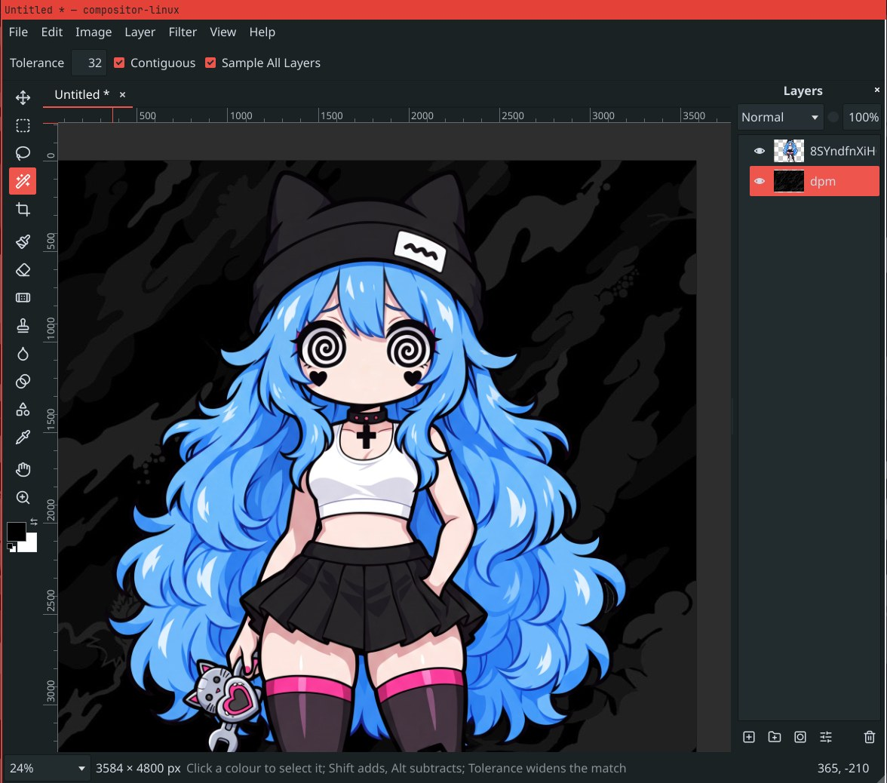
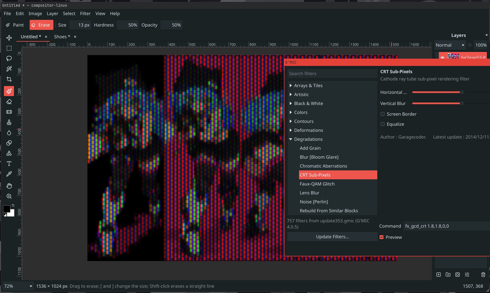

<p align="center">
  
</p>

# compositor-windows

A small, focused image editor for Windows: layers, masks, selections, brushes,
adjustments and filters, with Photoshop-style tools and shortcuts and none of
the bloat.

It is a Windows port of **[compositor-linux](https://github.com/vomitselfie/compositor-linux)**,
which is itself a Qt 6 / C++20 port of the macOS app
**[Compositor](https://github.com/robbietilton/Compositor)** by Wonder Assembly
LLC. All three share one document model and open the same `.comp` projects, so
files move between them freely. The Mac sources under `Compositor/` and
`Compositor.xcodeproj` are kept in this tree as the reference the port is built
against.

<p align="center">
  
</p>

<p align="center">
   G'MIC: the catalogue's folders on the left, a CRT sub-pixel filter's controls on the right, and its live preview on the canvas" width="800">
  <br>
  <sub>Filter &gt; G'MIC: over 700 filters with their own controls and a live preview.</sub>
</p>

## Get it

There is no prebuilt Windows installer yet: build from source in an MSYS2
MINGW64 shell, as below, and run `build-win/src/app/compositor-linux.exe`.

On Linux and macOS the upstream
[compositor-linux releases](https://github.com/vomitselfie/compositor-linux/releases)
carry a self-contained AppImage and an Apple Silicon app bundle; the same
sources build here unchanged.

Open an image with File > Open or drop it on the window, and go.

## What you get

- Layers, folders, blend modes, opacity, and layer masks
- Move, scale, rotate and distort without losing pixels
- Marquee, lasso and magic wand selections; content-aware fill
- Brush, eraser, spot healing, clone stamp, smudge, gradient and shape tools
- Levels, curves, hue/saturation, exposure, gradient map, grain, blurs, noise
- Remove Background with a local model, if you turn it on in Preferences
- Text layers in any installed font, editable until painted on
- Opens Photoshop PSD files with their layers, folders, masks and blend modes
- The G'MIC filter library (700+ filters) through Filter > G'MIC, when `gmic` is installed
- Multiple projects in tabs; PNG and JPEG export
- The keyboard shortcuts you already know

The full list is in [docs/features.md](docs/features.md).

## Windows notes

The Windows port keeps the whole editor and its automation surface, and adds a
few things the platform needs:

- **HEIC/HEIF import.** Qt ships no HEIC plugin on Windows, so HEIC/HEIF files
  are decoded through [libheif](https://github.com/strukturag/libheif) when it
  is installed (`-DCOMPOSITOR_WITH_LIBHEIF`, on by default), falling back to a
  Qt plugin when the distribution provides one. See `src/app/Heif.cpp`.
- **Automation over a named pipe.** `--rpc-socket name` listens on
  `\\.\pipe\name`; the Python tools (`tools/rpc_smoke.py`,
  `mcp/compositor_mcp.py`) open the pipe directly, because CPython on Windows
  has no `AF_UNIX`. `--headless` still works, so the whole automation surface is
  available.
- **No DBus autolaunch hang.** Qt6DBus is linked in for the XDG portal colour
  scheme; on Windows, `main()` sets `DBUS_SESSION_BUS_ADDRESS=disabled:` when no
  bus is configured, so libdbus never spawns a `dbus-daemon` that outlives the
  process and holds a caller's stdout pipe open.

## Remove Background

Off by default. Edit > Preferences > AI background removal downloads a
segmentation model (from the rembg project) into your data folder and runs it
on your machine. Nothing is uploaded anywhere.

## Use it with an AI agent

The editor can be driven by Claude Code or any MCP client: open files, inspect
and edit layers, run adjustments and filters, and look at the result.

```bash
claude mcp add compositor -- uv run /path/to/compositor-windows/mcp/compositor_mcp.py
```

Then ask for things like "open photo.jpg, remove the background, add a dark
gradient behind it and export result.png". Details, the protocol and the full
method list are in [docs/automation.md](docs/automation.md).

## Build on Windows

In an "MSYS2 MINGW64" shell:

```bash
pacman -S mingw-w64-x86_64-{gcc,cmake,ninja,qt6-base,qt6-svg,qt6-imageformats,libpng,opencv,libheif}
cmake -S . -B build-win -G Ninja -DCMAKE_BUILD_TYPE=RelWithDebInfo
cmake --build build-win -j
ctest --test-dir build-win --output-on-failure
./build-win/src/app/compositor-linux.exe
```

The root `CMakeLists.txt` sets `_USE_MATH_DEFINES`, `NOMINMAX` and
`WIN32_LEAN_AND_MEAN` for MinGW (its `<math.h>` hides `M_PI` otherwise, and
`<windows.h>` defines `min`/`max` as macros). OpenCV comes from MSYS2
(`mingw-w64-x86_64-opencv`) and supplies the DNN module Remove Background
needs.

## Build on Linux and macOS

Arch / Manjaro:

```bash
sudo pacman -S cmake ninja qt6-base qt6-svg qt6-wayland qt6-imageformats libpng opencv
```

Ubuntu 24.04:

```bash
sudo apt install cmake ninja-build qt6-base-dev qt6-svg-dev qt6-wayland qt6-image-formats-plugins libpng-dev libgl1-mesa-dev libopencv-dev
```

macOS (Homebrew), where the build produces an app bundle instead:

```bash
brew install cmake ninja qt libpng opencv pkg-config
cmake -S . -B build -G Ninja -DCMAKE_BUILD_TYPE=Release -DCMAKE_PREFIX_PATH="$(brew --prefix qt)"
cmake --build build -j && open build/src/app/compositor-linux.app
```

Then, on Linux:

```bash
cmake -S . -B build -G Ninja -DCMAKE_BUILD_TYPE=Release
cmake --build build -j
./build/src/app/compositor-linux
```

`docs/linux-port.md` has the build options, command-line flags, the source
layout, how releases are made and the keyboard shortcuts.
`docs/linux-port-architecture.md` explains how the port relates to the Mac
sources, which stay in this tree untouched.

## Credits and license

This project stands on two open-source projects, and could not exist without
them:

- **[Compositor](https://github.com/robbietilton/Compositor)** — the original
  macOS image editor by Wonder Assembly LLC, whose document model, compositor,
  pixel routines and `.comp` format this port reproduces. Its README is kept at
  `docs/upstream-README.md`.
- **[compositor-linux](https://github.com/vomitselfie/compositor-linux)** — the
  Qt 6 port this Windows port is built on; the portable C++ core, the Qt
  front end and the build system all come from there.

Both are MIT licensed. This project is MIT as well, see [LICENSE](LICENSE). It
also bundles nlohmann/json (MIT) and the Lucide icons (ISC).
